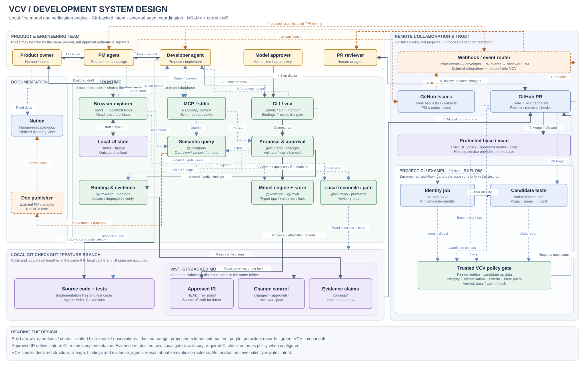

# Vibe Code Visualiser

*Working name.* Vibe Code Visualiser (VCV) is a local-first tool for building software with
coding agents **module by module**, with a model of the app that people and agents share,
instead of one-shot generation of code nobody can follow.

At its centre is a versioned, typed model of the application: its modules, capabilities, data,
rules, events, contracts and behaviour. Agents read that model to understand what a change
touches. Humans review and approve changes to it. Later milestones bind it to real source code,
so VCV can show what was implemented and flag where the code no longer matches the agreed design.

> Vibe coding with a software engineering team, not just a coding agent.

## Why

Coding agents are good at writing code and bad at keeping a whole system in their head.
Once an app grows past a few files, a person who can't read the code loses track of what it
does, and the agent guesses at structure it can't see. VCV keeps three things apart and makes
them visible:

- **Intent**: the approved model, changed only through typed, reviewable proposals.
- **Code**: what the repository actually contains, observed at a specific commit.
- **Evidence**: tests and checks that connect the two.

When they disagree, VCV reports it and asks for a decision. It never silently rewrites
approved intent to match the code, or the other way round.

## Architecture



[Open the editable Excalidraw source](docs/assets/vcv-architecture.excalidraw) · [Architecture decision records](docs/adr/)

The diagram shows the implemented M0–M4 engine, agent interfaces, repository-backed model,
and model-first development loop. The M5 visual canvas is **planned**, not implemented.
The IR is approved intent; source code and verification evidence remain distinct.

## Status

Early and pre-release. The engine works from the command line and from coding agents over MCP.
A model lives in a `.vcv/` folder inside your Git repository, is bound to the source code it
describes, changes only through reviewed proposals, and is checked against every pull request
before it merges. An architecture explorer runs locally in the browser, where you can also
draft model edits and hand them to a coding agent.

| Milestone | What it delivers | Status |
|---|---|---|
| **M0** Semantic foundation | Typed IR, validation, change/approval engine, file store with crash recovery, audit log, read-only query API, CLI | ✅ Done |
| **M1** Local MCP for agents | stdio MCP server with read-only query tools, opt-in agent guidance, Claude Code demo | ✅ Done ([#5](https://github.com/TheBluemist1404/vibe-code-visualiser/pull/5)) |
| **M2** Repository integration | `.vcv/` in the repo, branch-safe revisions, a reference app, agent-drafted first models, portable model↔code binding claims resolved for TypeScript, source evidence queries | ✅ Done ([#6](https://github.com/TheBluemist1404/vibe-code-visualiser/issues/6)) |
| **M3** Approved model → code | Agent proposes model changes, a reviewer approves with a signed attestation, a coding agent implements from a bounded handoff, VCV records what was implemented | ✅ Done ([#17](https://github.com/TheBluemist1404/vibe-code-visualiser/issues/17)) |
| **M4** Code → model reconciliation | Pre-merge reconciliation of a PR against its base, acceptance criteria mapped to tests, per-test runner evidence, a policy gate for CI | ✅ Done ([#22](https://github.com/TheBluemist1404/vibe-code-visualiser/issues/22)) |
| **M5** Local visual product | Module graph, change review and evidence panels in a local UI | In progress: explorer, drafted edits and the proposal inbox ([#39](https://github.com/TheBluemist1404/vibe-code-visualiser/issues/39)) |

M0 to M4 make up the technical MVP; M5 makes it usable without reading code. Everything is
single-user and local for now. CLI, agent and UI processes writing the same checkout take turns
through a lock in `.vcv/cache/`; Git and other tools are detected, not blocked
([ADR 0010](docs/adr/0010-writer-lock.md)).

## Quick start

Requires **Node 22.18 or newer**. TypeScript runs directly; only the explorer's browser client is built (by `npm run ui`).

```sh
git clone https://github.com/TheBluemist1404/vibe-code-visualiser.git
cd vibe-code-visualiser
npm install
npm test             # run the test suite
npm run typecheck
```

### Try the engine on the sample model

The repository ships a small LMS model (Enrollment and Notifications modules) and one change
to it: rejecting an enrollment request automatically after seven days.

```sh
# Check the model and start a store from it
npm run vcv -- validate examples/enrollment/model.rev-1.yaml
npm run vcv -- init .vcv-store examples/enrollment/model.rev-1.yaml

# An agent proposes the change; a human approves it, creating a new revision
npm run vcv -- propose .vcv-store examples/enrollment/change.timeout.yaml --as agent:mcp --perm propose
npm run vcv -- approve .vcv-store ch-timeout-01 --as hoang

# Look at the result
npm run vcv -- show .vcv-store --tree
npm run vcv -- query .vcv-store search enrollment notifications --kind module
npm run vcv -- query .vcv-store impact evt-enrollment-rejected
```

Revision IDs after the first look like `rev-2-84dfbfe94209`: the digest keeps two Git
branches from minting the same ID. Run `npm run vcv` with no arguments for the full command list. `--as` and `--perm` simulate
the identity a real host would supply; they are not authentication.

### Keep the model in your repository

A VCV project lives in `.vcv/` at the root of a Git checkout and is committed with the code.

```sh
npm run vcv -- project init <checkout> examples/enrollment/model.rev-1.yaml   # create <checkout>/.vcv
npm run vcv -- project status <checkout>                                      # model and Git state, read-only
```

`project status` works from any subdirectory and reports whether the project is ready,
absent, conflicted, diverged or invalid, along with the checkout's commit, branch and dirty
state. It never creates or repairs anything. A merged or half-merged `.vcv/` is refused rather
than silently reset. See [ADR 0007](docs/adr/0007-repository-projects.md).

### Explore the architecture in the browser

```sh
npm run ui -- <checkout>            # builds the client, then serves http://127.0.0.1:4870/
```

The explorer shows the checkout's modules on one canvas, with an arrow from each module to the
modules it depends on. Select a module to see its purpose, dependencies and what it owns, and
drill into any capability, rule, data or criterion. Drag a module to pin it; positions are kept
on your computer (not in `.vcv/`) and survive restarts and branch switches. The explorer keeps
watching the checkout: when the model changes on disk it says so, keeps your layout, and places
new modules in free space. An absent, conflicted or invalid project is reported as it is; the
explorer never creates, repairs or rewrites anything in the checkout.

You can also draft edits in the inspector: a module's or object's name and description, a
rule's or criterion's statement, and a module's dependencies. Each staged edit is a typed
operation in a local draft, kept on your computer outside the checkout, so it survives restarts.
The engine checks the draft as you go (errors, warnings, before and after, modules touched).
**Hand off to agent** gives you the draft as a proposed change file that `vcv proposal preview
--file` accepts, for your coding agent to integrate and submit. The explorer never submits or
approves anything, and a draft whose model has moved is marked stale rather than moved onto the
new model. Fields without a typed operation, such as a module's purpose, are read-only with the
reason.

The **Proposals** page lists every proposal recorded in the checkout (pending, stale, rejected,
applied or unreadable) and, for one of them, the engine's check, the before and after, the
modules and code it touches, and where it stands as separate facts: submitted, signed by a
reviewer, attested under the protected base, applied to the model, and implemented (never
claimed here). A pending proposal shows the exact `vcv review approve` command for its digest:
approval happens in the reviewer's own terminal with their key, never in the browser. Start the
explorer with `--protected-base origin/main` to have it check attestations against that ref; it
labels the result caller-asserted, because CI's `vcv integrity` is the authority.

Selecting an object also shows its **code and test evidence**:
- every binding claim about it, whether its pointer still resolves, and whether the code or the
  model object changed since the claim (and why);
- for a criterion, its mapped test cases and their results in the test-run records you name with
  `--run`.

An applied proposal shows its implementation in three separate layers: what was approved, what
the agent reports (as claims), and what VCV observes in the checkout now.

The **Before merging** page shows reconciliation and the policy gate exactly as `vcv reconcile`
and `vcv gate` compute them. It needs `--base-commit <sha>`, the protected branch's commit as
your hosting service reports it, and it never guesses one. Optionally add `--policy <file>`.
The explorer runs no tests, reasserts no claims and records nothing. See
[docs/ui.md](docs/ui.md).

The Proposals page needs Linux. It reads the checkout only through folder handles that cannot
be redirected outside it, and macOS and Windows offer no such reads to Node. On those systems the
page says the checkout cannot be observed safely. The `vcv` CLI works everywhere.

### Connect a coding agent

```sh
node --experimental-strip-types apps/mcp/src/main.ts --store .vcv-store
```

This starts a read-only MCP server over stdio for one store (or `--repo <checkout>` for a
`.vcv/` project, which adds source-evidence and proposal tools). Any MCP client (Claude Code,
Codex and others) can then call `vcv_get_project_overview`, `vcv_search_objects`,
`vcv_get_context` and `vcv_analyze_impact`. Results describe the model only
(`implementationChecked: false`), so agents still need to check the code itself.
Client configs, opt-in `CLAUDE.md` / `AGENTS.md` guidance and the recommended agent workflow
are in [apps/mcp/README.md](apps/mcp/README.md).

### Change the model, then the code

The full loop (an agent proposes a model change, a reviewer approves it, a coding agent
implements it, and the pull request is reconciled and gated before merge) is walked through
end to end on the Course Desk reference app in [the golden path](docs/golden-path.md) and
[pre-merge reconciliation](docs/reconciliation.md). The main commands:

```sh
npm run vcv -- proposal ...        # submit and preview model proposals
npm run vcv -- review approve ...  # trusted reviewer approval with a signed attestation
npm run vcv -- handoff ...         # the bounded brief a coding agent implements from
npm run vcv -- reconcile ...       # compare a candidate checkout with its protected base
npm run vcv -- gate ...            # the pre-merge policy decision for CI
```

## Repository layout

```
packages/ir        The model (IR): types, schema, validation, YAML load/dump, tree and graph views
packages/core      Typed operations, ModelEngine (propose/approve), model stores, audit log, layout
packages/query     Read-only semantic queries: overview, search, context, impact
packages/repo      .vcv/ in a Git checkout: bindings, proposals, review, handoff, pre-merge checks
packages/testkit   Private helpers shared by the test suites
apps/cli           `vcv` command-line tool, a thin layer over the engine
apps/mcp           Local stdio MCP server for coding agents
apps/ui            Local architecture explorer: a host on 127.0.0.1 and a React client
examples/          Sample Enrollment model, and the Course Desk reference app
docs/              Guides, design notes and architecture decision records
```

Every interface (CLI, MCP and the explorer) calls the same engine operations. None of
them holds its own copy of the model or its own rules.

## Documentation

- **Guides for agents and people**: [bootstrapping a first model](docs/agent-bootstrap.md),
  [maintaining it after code changes](docs/agent-maintenance.md),
  [the model-first golden path](docs/golden-path.md),
  [the end-to-end acceptance walkthrough](docs/acceptance.md), [the MCP server](apps/mcp/README.md)
- **How each part works**: [binding claims](docs/bindings.md) and
  [source evidence](docs/evidence.md) (where the code for a model object is) ·
  [proposals](docs/proposals.md) · [trusted approval and integrity](docs/approvals.md) ·
  [handoff and implementation reports](docs/implementation.md) ·
  [pre-merge reconciliation](docs/reconciliation.md) · [acceptance criteria](docs/criteria.md) ·
  [test evidence](docs/test-evidence.md) (what the tests returned on a candidate) ·
  [the pre-merge gate](docs/premerge-gate.md) · [the reference app](docs/reference-app.md) ·
  [the architecture explorer](docs/ui.md)
- **Architecture decisions** in [docs/adr](docs/adr), 0001 to 0009
- [IR v0.2 conformance](docs/ir-v0.2-conformance.md): which tests cover the spec's acceptance
  cases, extra hardening, and decisions the spec left open
- [Sample semantic queries](docs/samples/semantic-queries.md) and the
  [recorded agent demo](docs/samples/mcp-agent-demo.md)

## Development

Working on VCV itself: [docs/development.md](docs/development.md) covers the workspace, package
boundaries, scripts, tests and conventions. CI ([.github/workflows/ci.yml](.github/workflows/ci.yml))
runs formatting and lint checks, typecheck and tests on Node 22.18.0 and the latest 22.x for
pushes to `main` and every pull request.
